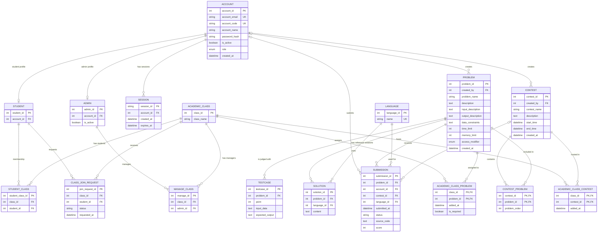

# Database schema

Tài liệu này mô tả schema SQLAlchemy đang dùng bởi backend. Nguồn khai báo
chính thức là `backend/db/tables_phase1.py` và `backend/db/tables_phase2.py`.
Backend kết nối cơ sở dữ liệu qua `DATABASE_URL` trong `backend/.env`; không
đưa URL hoặc thông tin xác thực vào tài liệu này.

> Khi thay đổi model, chạy các lệnh khởi tạo/migration trong README trước khi
> khởi động backend. Đặc biệt, `initialize_tables.py` tạo bảng còn thiếu nhưng
> không tự thêm cột mới vào bảng đã tồn tại; `migrate_judge_admin.py` xử lý
> những thay đổi bổ sung như `problem.data_constraints`.

## Entity relationship diagram

`o|` represents an optional relationship, `||` exactly one, and `o{` zero or
many. `UK` means a unique constraint. In particular, owner/account references
on `PROBLEM`, `CONTEST`, and `SUBMISSION` are nullable so judge history can
remain after an account is removed.

## Tables

All IDs described as generated are integer identity/auto-increment primary keys
unless stated otherwise. `created_at`, `requested_at`, `added_at`, and
`submitted_at` use a database timestamp default where applicable.

### Accounts and access

| Table | Columns |
|---|---|
| `account` | `account_id` integer PK; `account_email` varchar(100) required, unique; `is_active` boolean required, default `true`; `account_code` varchar(20) required, unique; `account_name` varchar(100) required; `password_hash` varchar(255) required; `created_at` timezone-aware timestamp required, default current time; `role` enum `account_role` required (`USER`, `ADMIN`, `SUPER_ADMIN`), application default `USER`. |
| `student` | `student_id` integer PK; `account_id` integer required FK → `account.account_id`, unique. An account can have at most one student profile. |
| `admin` | `admin_id` integer PK; `account_id` integer required FK → `account.account_id`, unique; `is_active` boolean required, default `true`. An account can have at most one admin profile. |
| `session` | `session_id` varchar(64) PK; `account_id` integer required FK → `account.account_id`; `created_at` timezone-aware timestamp required, default current time; `expires_at` timezone-aware timestamp required. |

Roles live on `account`; the `student` and `admin` tables are separate role
profiles. Authentication sessions belong to one account.

### Classes and membership

| Table | Columns and constraints |
|---|---|
| `academic_class` | `class_id` integer PK; `class_name` varchar(300) required. |
| `manage_class` | `manage_id` integer PK; `class_id` required FK → `academic_class.class_id`; `admin_id` required FK → `admin.admin_id`; unique (`class_id`, `admin_id`). |
| `student_class` | `student_class_id` integer PK; `class_id` required FK → `academic_class.class_id`; `student_id` required FK → `student.student_id`; unique (`class_id`, `student_id`). |
| `class_join_request` | `join_request_id` integer PK; `class_id` required FK → `academic_class.class_id` with `ON DELETE CASCADE`; `student_id` required FK → `student.student_id` with `ON DELETE CASCADE`; `status` varchar(20) required, default `pending` (application states: `pending`, `accepted`, `rejected`); `requested_at` timezone-aware timestamp required, default current time; unique (`class_id`, `student_id`). |

`manage_class` and `student_class` are join tables: admins and students can each
be associated with multiple classes. `class_join_request` tracks a student's
request separately from an accepted `student_class` membership.

### Problems, judging, and languages

| Table | Columns and constraints |
|---|---|
| `problem` | `problem_id` integer PK; `problem_name` varchar(255) required; `description`, `input_description`, `output_description`, `data_constraints` nullable text; `time_limit` integer required, check `0 < time_limit <= 10` (seconds); `memory_limit` integer required, check `0 < memory_limit <= 1024` (MB); `created_by` nullable integer FK → `account.account_id`; `created_at` timezone-aware timestamp required, default current time; `access_modifier` enum `access_modifier_enum` required (`private`, `public`), default `private`. |
| `testcase` | `testcase_id` integer PK; `problem_id` integer required FK → `problem.problem_id`; `point` integer required; `input_data` and `expected_output` required text. |
| `solution` | `solution_id` integer PK; `problem_id` integer required FK → `problem.problem_id`; `language_id` integer required FK → `language.language_id`; `content` required text. Stores reference solutions, not user submissions. |
| `language` | `language_id` integer PK (ID synced from Judge0); `name` varchar(50) required, unique. |
| `submission` | `submission_id` integer PK; `problem_id` integer required FK → `problem.problem_id`; `account_id` nullable integer FK → `account.account_id`; `contest_id` nullable integer FK → `contest.contest_id` with `ON DELETE SET NULL`; `language_id` integer required FK → `language.language_id`; `submitted_at` timezone-aware timestamp required, default current time; `status` varchar(50) required; `source_code` nullable text; `score` nullable integer. |

The database stores problem statements and judging limits, while the
`testcase` table stores private judge data. Problem access is controlled by
`access_modifier`; application authorization determines who may read or edit
private problem details and test cases.

### Contests and class assignments

| Table | Columns and constraints |
|---|---|
| `contest` | `contest_id` integer PK; `contest_name` varchar(255) required; `description` nullable text; `start_time` and `end_time` timezone-aware timestamps required; `created_by` nullable integer FK → `account.account_id`; `created_at` timezone-aware timestamp required, default current time; check `end_time > start_time`. |
| `contest_problem` | Composite PK (`contest_id`, `problem_id`); `contest_id` FK → `contest.contest_id` with `ON DELETE CASCADE`; `problem_id` FK → `problem.problem_id`; nullable integer `problem_order`; unique (`contest_id`, `problem_order`); check order is null or between 1 and 20. A contest is limited to 20 problems by application validation as well. |
| `academic_class_problem` | Composite PK (`class_id`, `problem_id`); `class_id` FK → `academic_class.class_id` and `problem_id` FK → `problem.problem_id`, both with `ON DELETE CASCADE`; `added_at` timezone-aware timestamp required, default current time; `is_required` boolean required, default `false`. |
| `academic_class_contest` | Composite PK (`class_id`, `contest_id`); `class_id` FK → `academic_class.class_id` and `contest_id` FK → `contest.contest_id`, both with `ON DELETE CASCADE`; `added_at` timezone-aware timestamp required, default current time. |

`academic_class_problem` and `academic_class_contest` implement many-to-many
assignments. A problem can be reused in multiple classes and contests without
copying its statement or test cases.

## Relationship summary

- `account` 1 — 0..1 `student`; `account` 1 — 0..1 `admin`.
- `account` 1 — many `session`.
- `account` 1 — many owned `problem` and `contest`; these ownership links are
  optional (`created_by` can be `NULL`).
- `account` 1 — many `submission`; the submitter link is optional so a
  submission can be retained without its account.
- `admin` many — many `academic_class` through `manage_class`.
- `student` many — many `academic_class` through `student_class`; join requests
  are stored in `class_join_request`.
- `problem` 1 — many `testcase`, `solution`, and `submission`.
- `language` 1 — many `solution` and `submission`.
- `contest` many — many `problem` through `contest_problem`.
- `academic_class` many — many `problem` through `academic_class_problem`.
- `academic_class` many — many `contest` through `academic_class_contest`.
- `contest` 1 — many `submission`; deleting a contest sets the submission's
  `contest_id` to `NULL` at the database level.

## Deletion and migration notes

- Database `ON DELETE` actions are explicitly configured only on the foreign
  keys listed above. Other cleanup behavior is performed by ORM cascades or
  application routes; do not assume every relationship is deleted by the
  database alone.
- The account deletion flow clears nullable owner/submitter references so
  problem, contest, and submission records can be preserved.
- Administrative deletion routes explicitly remove dependent test cases,
  solutions, submissions, and class/contest links as appropriate.
- Run `PYTHONPATH=. .venv/bin/python db/initialize_tables.py` for missing
  tables, then `PYTHONPATH=. .venv/bin/python db/migrate_judge_admin.py` to
  apply incremental judge schema changes. The migration is intended to be
  repeatable.
- `backend/db/initialize/creating.py` contains older duplicate `Problem` and
  `Contest` declarations. The active application metadata is assembled from
  `tables_phase1.py` and `tables_phase2.py`; use those files when changing the
  live schema.
